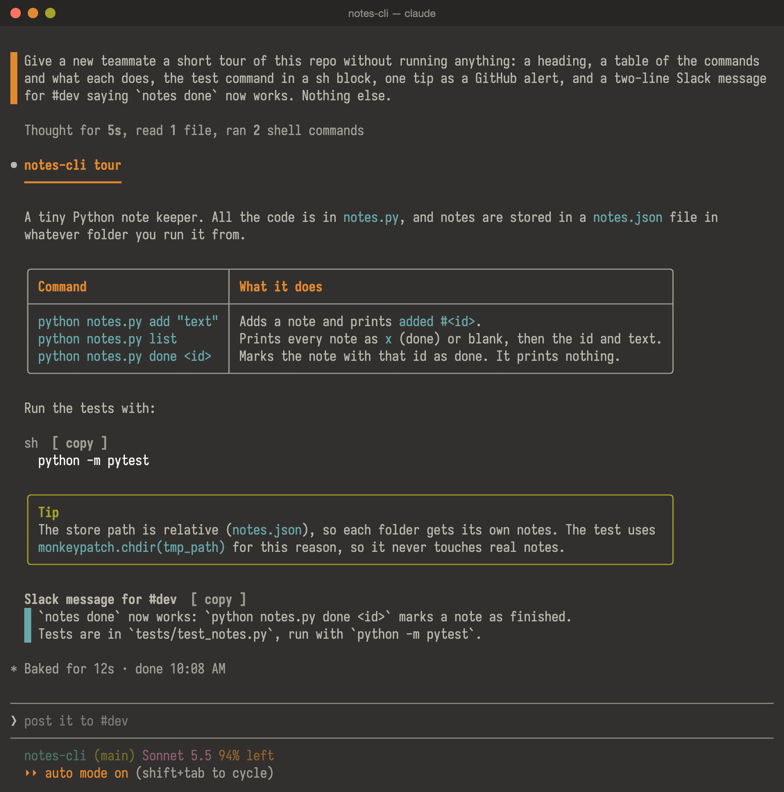
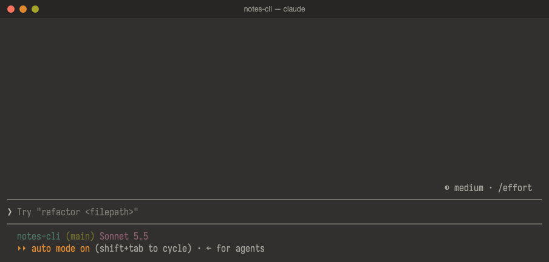
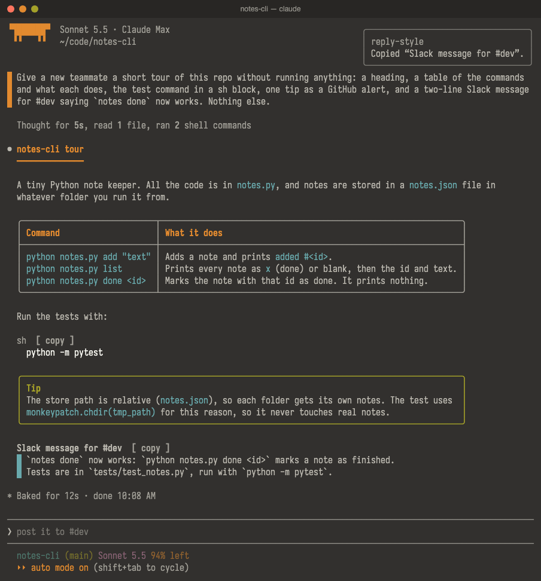
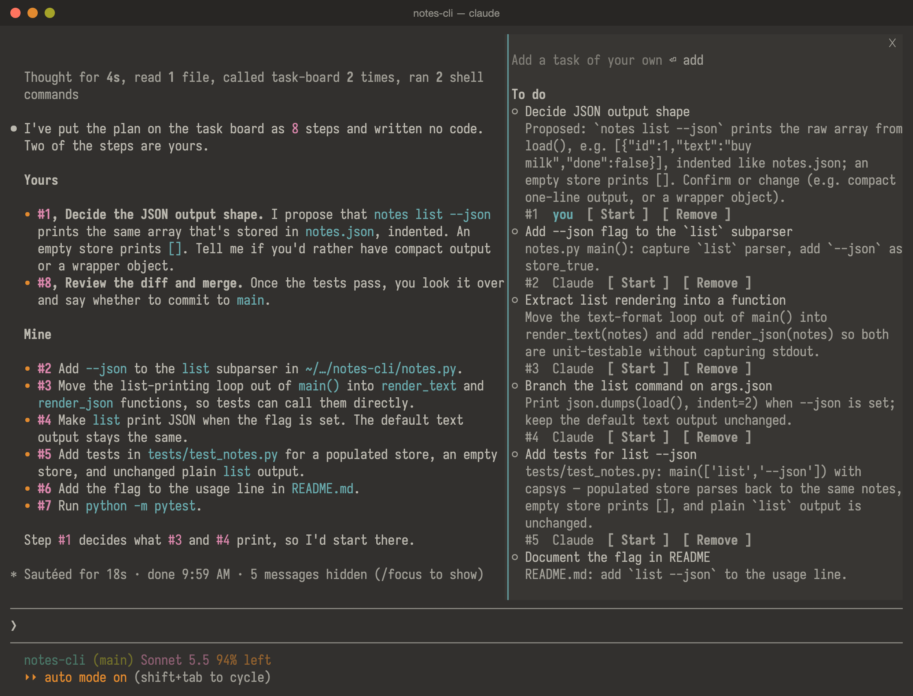
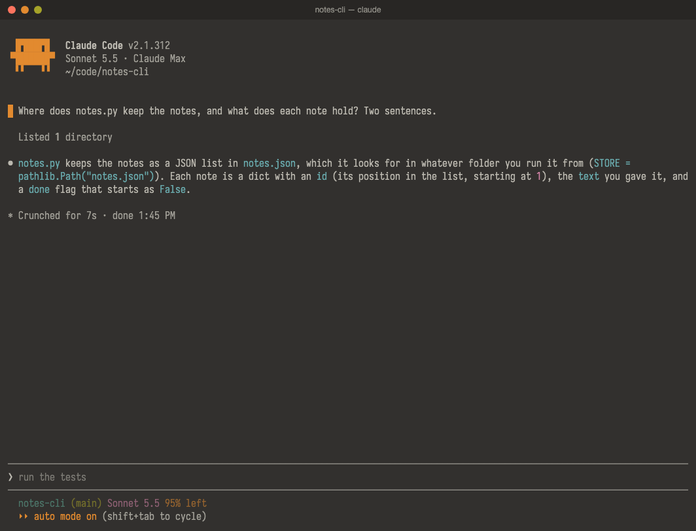
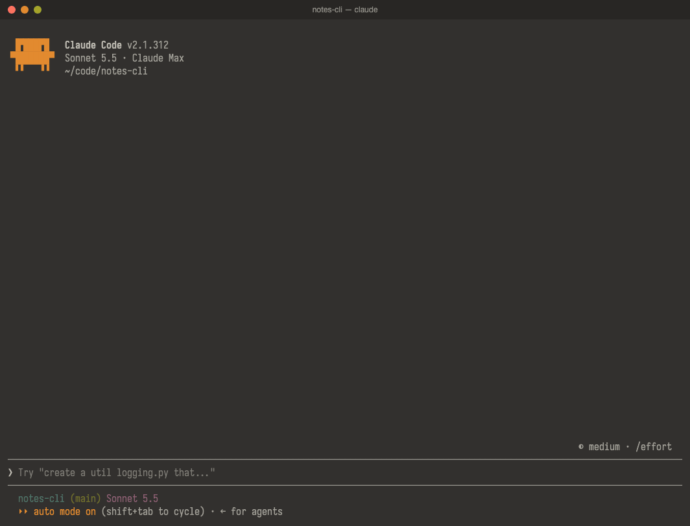
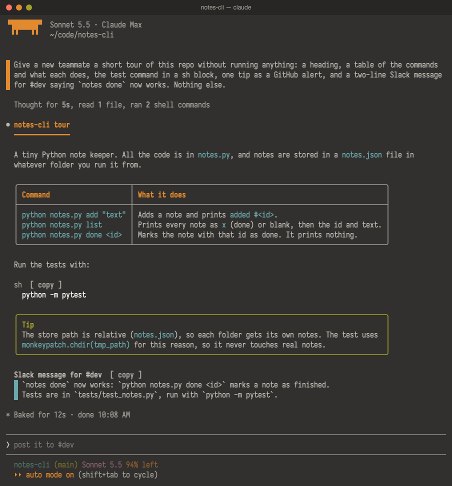
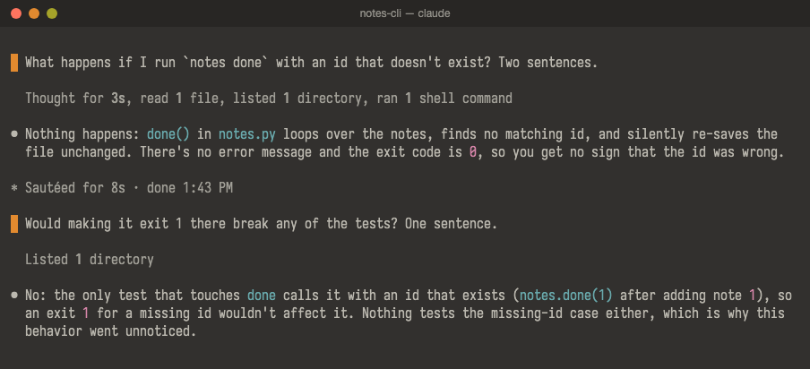
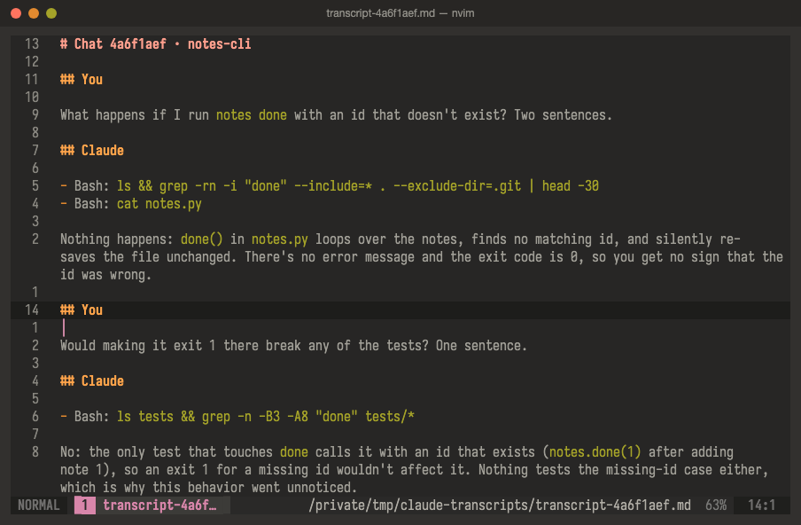
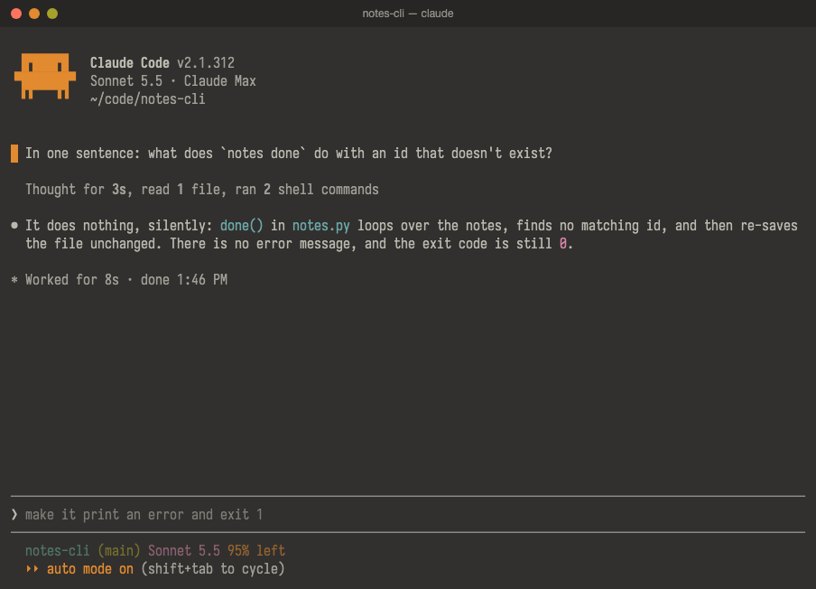

# claude-mods

Eleven mods for the Claude Code terminal app. They add what it doesn't ship: a button that rewrites a vague
prompt before you send it, side questions in a pane that stay out of the conversation, a task board and an
idea shelf for each project, a pane that walks you through Claude's questions one at a time, replies drawn
in your theme's colours with copy buttons, a search that scrolls the chat back to a prompt you typed, and a
`/restart` that works with Remote Control on.



## Install

The mods run on macOS and need Claude Code (built and tested on 2.1.312) and `node`. Two mods use
optional extras: walkthrough draws diagrams as pictures with `rsvg-convert` (`brew install librsvg`), and
transcript opens the chat in a [Mado](https://github.com/dautroc/mado) float.

```sh
git clone git@github.com:dautroc/claude-mods.git ~/tools/claude-mods
cd ~/tools/claude-mods
make install
```

`make install` adds this folder as the `claude-mods` marketplace and installs every mod at user scope, so
each new session loads them. In a session that is already running, run `/reload-plugins`.

To leave one mod out, disable it: `claude plugin disable prompt-style@claude-mods`.

**Use the fullscreen layout.** The panes dock beside the transcript, the buttons in Claude's replies take
clicks, and `ctrl+x y` works only there. Turn it on with `"tui": "fullscreen"` in
`~/.claude/settings.json`; if a terminal still shows the classic layout, start Claude Code with
`CLAUDE_CODE_NO_FLICKER=1`. Panes share one dock, with a tab each; its ✕ closes it.

## The mods at a glance

| Mod | What you get | Start with |
|---|---|---|
| [prompt-enhancer](#prompt-enhancer-rewrite-a-vague-prompt) | Your draft rewritten into a specific prompt before you send it | Type a draft, click ✨ Enhance |
| [aside](#aside-ask-a-side-question) | Questions about the chat answered in a pane, outside the conversation | `/aside <question>` |
| [task-board](#task-board-the-agents-plan-on-a-board) | A task list per project that the agent keeps as it works | `/board` |
| [idea-shelf](#idea-shelf-park-an-idea-for-later) | Ideas saved per project without interrupting Claude | `/idea <text>`, `/ideas` |
| [walkthrough](#walkthrough-answer-claudes-questions-one-at-a-time) | Claude's questions for you, one at a time in a pane | Opens by itself; `/walk` |
| [reply-style](#reply-style-replies-in-your-themes-colours) | Replies in your theme's colours, boxed tables, copy buttons | `/reply-style copy`, `ctrl+x y` |
| [prompt-style](#prompt-style-your-prompts-beside-a-bar) | Your prompts beside an orange bar instead of a grey band | Always on |
| [paste-thumbnails](#paste-thumbnails-see-the-images-you-paste) | A thumbnail of each pasted image above the prompt box | Paste an image |
| [prompt-jump](#prompt-jump-jump-back-to-a-prompt-you-typed) | A ctrl+r-style search of your prompts that scrolls the chat to the one you pick, and a jump to the start of Claude's last reply | `/jump`, `/jump-reply` |
| [transcript](#transcript-read-the-chat-in-nvim) | The chat as Markdown in nvim, to read and search | `/transcript` |
| [restart](#restart-restart-claude-code-in-place) | `/restart` that reloads your shell setup and keeps Remote Control | `/restart` |

## prompt-enhancer: rewrite a vague prompt



Type a rough prompt and a band appears above the box. Click **✨ Enhance** and the draft is replaced with a
specific version, written from the project's `CLAUDE.md` and `AGENTS.md` files, your skills and the
conversation so far. Edit it if you like, then click **Send**, or **Undo** to get your draft back. Enter
still sends whatever is in the box.

`/enhance <prompt>` does the same from the keyboard.

## aside: ask a side question



`/aside <question>` opens the Aside pane and answers from the conversation so far. Type follow-ups in the
pane's field; they stay in the same thread. The main conversation never sees the questions or the
answers: Claude sees only that you ran `/aside`. **New thread** starts over, and `/clear` empties the
thread.

When the side thread turns into something you want done, click **Hand off**, or run
`/aside-handoff [what you want done]`. It writes a request from the thread into the prompt box, after any
draft there, for you to edit and send. Press Esc to move from the pane to the box.

## task-board: the agent's plan on a board



While it plans, the agent adds each step to the project's board, marks a step in progress when it starts
it and done when it finishes. A step only you can take, such as merging a PR, running a deploy or testing
by hand, goes on the board as yours, and a toast tells you.

`/board` opens the board: in progress, to do, then done. Each task has **Start**, **Done** or **Reopen**,
and **Remove**; **Clear done** clears the finished ones; the field at the top adds a task of your own. The
agent sees your changes the next time it reads the board. Every worktree of a repository shares one board,
and it stays between sessions.

## idea-shelf: park an idea for later



`/idea <text>` saves an idea to this project's shelf without Claude seeing it, and works while Claude is
busy; a toast confirms it. `/ideas`, or `/idea` alone, opens the shelf: newest first, **Remove** on each,
and a field to type a new one. Like the board, the shelf belongs to the repository and stays between
sessions.

## walkthrough: answer Claude's questions one at a time



When Claude has two or more things for you to decide, it hands them to walkthrough instead of writing a
list in its reply, and ends its turn. A pane opens beside the chat with one item at a time: the context,
Claude's recommendation, the choices with the recommended one starred, and a diagram, table, code or diff
where that helps. If your keys are still in the prompt box, `/walk` moves them to the pane.

| Key | What it does |
|---|---|
| `j` / `k` | Move between the choices |
| `Enter` (or the choice's number, on a single-choice item) | Pick it and go to the next unanswered item |
| `Space` | Tick the choice and stay; an item that takes several keeps every tick |
| `h` / `l` | Previous / next item |
| `w` | Write your own answer or a note; Enter saves it, Esc clears it |
| `t` / `v` | Switch a diagram between picture, text and source / open its PNG |
| `s` | Show all your answers; `s` again sends them |

Your answers reach Claude as your next message. `/walk` reopens a review you haven't sent, and `/clear`
drops it. Diagrams show as pictures in terminals Claude Code draws images in (kitty, Ghostty, iTerm2, or
Mado with `CLAUDE_CODE_FORCE_TERMINAL_IMAGES=1`) when `rsvg-convert` is installed, and as box-drawing text
elsewhere. Sonnet hands questions over by itself; in testing, Haiku wrote them in its reply instead.

## reply-style: replies in your theme's colours

The screenshot at the top shows it. In the terminal, reply-style draws Claude's replies and markdown
command output in your theme's colours, following `/theme`: headings, lists, task lists, quotes and GitHub
alerts (`> [!TIP]`), tables boxed to fit the window (Japanese text included), and coloured numbers, paths,
inline code and links.

Each code block shows its language and a `[ copy ]` button. When Claude drafts something for you to paste
elsewhere, such as a Slack message, an email, a PR comment or a commit message, it puts it in a block of
its own under a label, and that block's `[ copy ]` copies exactly the text shown.



To copy without the mouse:

- `ctrl+x y` puts a letter beside each code block and draft on screen, the way flash.nvim labels jumps: `a`
  on the one nearest the prompt, then `s`, `d`, `f` and on up. Type a letter to copy that block; any other
  key takes the letters down. Bind it in the `Chat` context of `~/.claude/keybindings.json`:
  `"ctrl+x y": "command:flash-copy"`.
- `/reply-style copy` copies the last reply, `/reply-style copy code` its last code block, and
  `/reply-style copy draft` its last draft. These work mid-turn and outside the fullscreen layout.

The desktop, VS Code and mobile apps keep their own drawing, and show a draft as an ordinary code block.

## prompt-style: your prompts beside a bar



Each prompt you type sits beside a thin orange bar instead of on a full-width grey band. A slash command's
line and a prompt a mod sends, such as prompt-enhancer's Send, keep the band: Claude Code doesn't let a mod
redraw those rows.

## paste-thumbnails: see the images you paste

![Pasting a screenshot into a prompt: the box shows [Image #1] and a thumbnail labelled #1 appears in the band above it](docs/media/paste-thumbnails.gif)

Paste an image into the prompt box and a thumbnail appears in the band above it, labelled with the number
of its `[Image #N]` tag; it goes when the tag leaves the box. It needs a terminal Claude Code draws images
in: kitty, Ghostty and iTerm2 3.5 or later as they are, Mado with `CLAUDE_CODE_FORCE_TERMINAL_IMAGES=1`.
Elsewhere the thumbnail shows the image's size instead.

The mod reads the file Claude Code saves when you paste, which is not part of the plugin API, so a Claude
Code release may break it.

## prompt-jump: jump back to a prompt you typed

`/jump` opens a search over the prompts you typed in this chat, newest first, like `ctrl+r` for this
session. Type to narrow the list: a prompt matches when it holds every word you typed. Enter jumps to the
newest match, or press ↓ to pick another (or its number); the pane closes and the chat scrolls so that
prompt heads the screen. Esc closes it without moving. Bind it to a key with `"ctrl+x r": "command:jump"`
to open it from the prompt box.

`/jump-reply` scrolls the chat to the start of Claude's last reply: the text it ended on, after any tool
calls, so a long answer can be read from its top. It opens no pane, so it works with a draft in the box.
Bind it with `"ctrl+x l": "command:jump-reply"`.

Both need the fullscreen layout, where the chat scrolls. Prompts from before a compaction are listed only
while the chat still shows them. The mod finds each row in the session's transcript file, which is not
part of the plugin API, so a Claude Code release may break it.

## transcript: read the chat in nvim



`/transcript` writes the chat as Markdown, with a heading for each of your prompts, Claude's replies, and
each tool call as one line, then opens it in your editor in an enlarged Mado float at your newest prompt.
It works mid-turn; bind it to a key with `"ctrl+x e": "command:transcript"` if you use it often. Outside
Mado it writes the file to `$TMPDIR/claude-transcripts/` and tells you where. Turns from before a
compaction show as the summary that replaced them.

## restart: restart Claude Code in place



`/restart` (or `/update`) ends Claude Code and starts it again in the same terminal pane, from a login
shell that reads your shell's startup files again, and resumes the same session with the flags you started
it with. Changed settings, new exports in `~/.zshrc` and a newly installed Claude Code version all take
effect. It works with Remote Control on, where the built-in `/restart` refuses.

It needs Claude Code to have been started from a shell such as zsh or bash. Otherwise, or under
`--no-session-persistence`, the built-in `/restart` runs instead and a dim line says why. A variable you
removed from `~/.zshrc` stays set, because the new shell inherits the old environment.

## Working on the mods

Claude Code reads an installed mod from this folder, not from a copy, so after you edit one,
`/reload-plugins` in a running session loads the change; there is nothing to reinstall.

- `make test` validates the marketplace and each mod, then runs each mod's tests.
- [AGENTS.md](AGENTS.md) explains how each mod works and which behaviour a spike confirmed.
- To write a new mod, use the plugin-authoring skill, then follow "To add a mod" in AGENTS.md.
